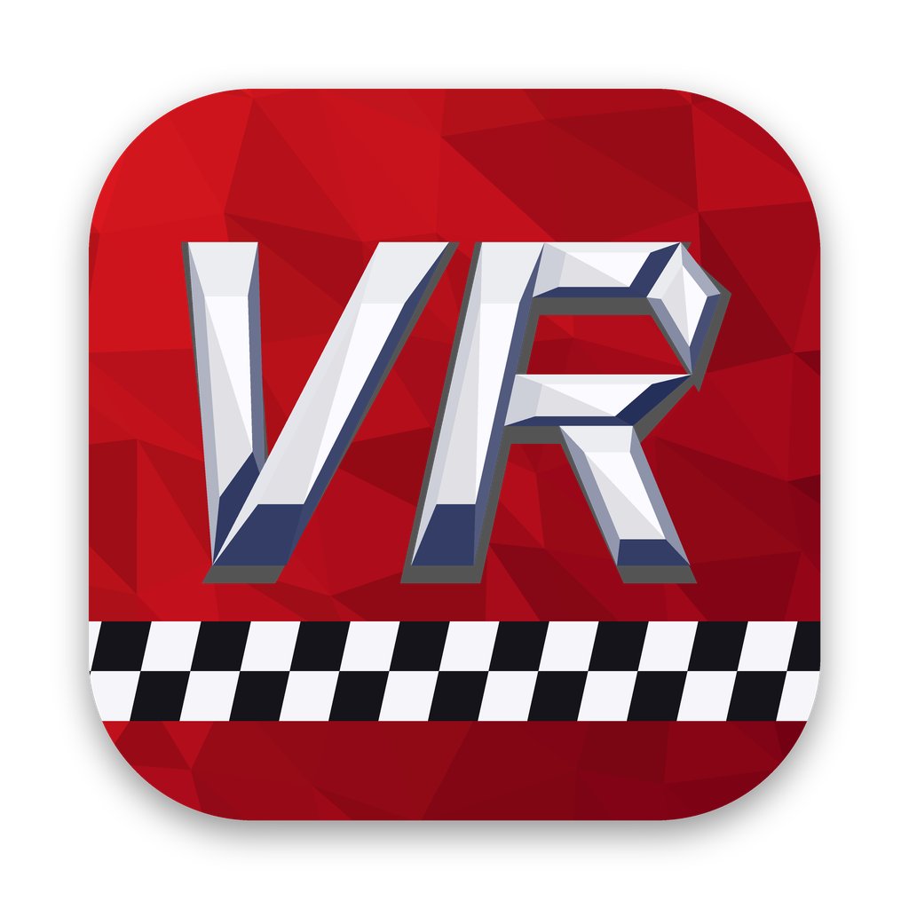
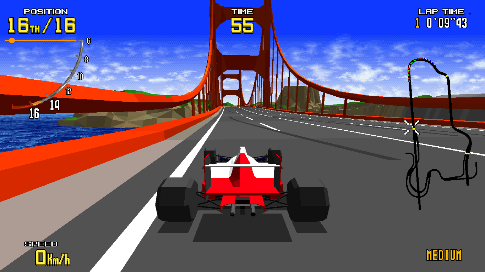
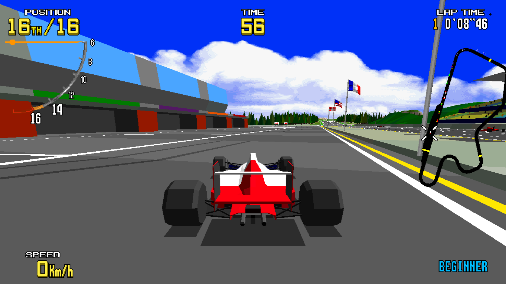
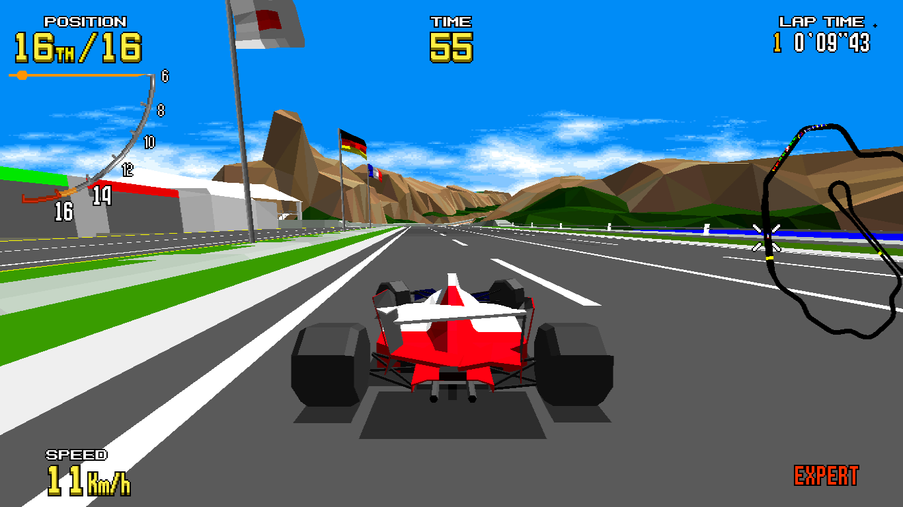

# Model 1 Recomps

<p align="center"><b>SEGA's classic arcade games on your computer, with sharper graphics,
widescreen support, and smooth motion at up to 120 FPS.</b></p>

This project forks Mr. Finster's superb [Virtua Fighter recomp](https://github.com/mr-finster/vf1-recomp), refactoring it to support the rest of Sega's Model 1 arcade hardware games library as native desktop runtimes. The Model 1 was used by
multiple games; this repository currently supports Virtua Racing.

<p align="center">
  <a href="https://github.com/svera/model1-recomps/releases"></a>
  <a href="LICENSE"></a>
  
</p>
<p align="center"></p>

<h2 align="center">Virtua Racing Recomp</h2>

<p align="center">
  
</p>

> [!IMPORTANT]
> You need your own **`vr.zip`** and **`model1io.zip`** ROM archives. Neither is included.
> Both are needed for steering and pedals to work. This is an unofficial fan project,
> not affiliated with or supported by SEGA.

<p align="center">
  <a href="https://github.com/svera/model1-recomp/releases">Download</a> ·
  <a href="#getting-started">Getting started</a> ·
  <a href="#controls">Controls</a> ·
  <a href="https://github.com/svera/model1-recomp/issues">Report a bug</a>
</p>

### Features

- All three courses, four camera views, and the original arcade racing.
- Sharper graphics, widescreen and ultrawide views without stretching the HUD.
- Original arcade motion or smoother 60 / 120 FPS.
- Full-detail models by default, with an optional LOD toggle for simpler distant models.
- Keyboard and gamepad support, with customizable controls.
- Saved settings and high scores.
- Car color, language, difficulty, and course settings.

**Single-player only.** Split screen, linked cabinets, and online multiplayer are not supported.

### Getting started

1. [Download](https://github.com/svera/model1-recomp/releases) the package for your system and extract it.
2. Keep **`vr.zip`** and **`model1io.zip`** together in the same folder. Leave them zipped.
3. Start the game and select **`vr.zip`** when asked. It remembers your files for next time.
4. Press **1** on the keyboard or **Start** on your gamepad to play.

**macOS:** open **Virtua Racing Recomp.app**. If macOS blocks it, allow it through
**System Settings > Privacy & Security**.

**Windows:** run the included executable. Windows may show a SmartScreen warning for preview builds.

**Steam Deck / Linux:** put both ROM archives in the package's **roms** folder and run
**VirtuaRacing.sh** instead of using a file picker. On Steam Deck, add the launcher as a
Non-Steam Game and set **Start In** to the extracted **VirtuaRacing** folder.

### Controls

| Action | Keyboard | Gamepad |
| --- | --- | --- |
| Steer | Left / Right | Left stick |
| Accelerate | Up | Right trigger |
| Brake | Down | Left trigger |
| Shift up / down | X / Z | A / B (Cross / Circle) |
| Change camera | C | Y / Triangle |
| Start | 1 | Start |
| Insert coin (Arcade mode) | 5 | D-pad Up |
| Open menu | Esc | View / Select |

To see or change your actual controller bindings, open **Esc > Controls > Player 1 >
Pad buttons**. Coins are only needed in Arcade play style.

### Useful settings

Open the menu with **Esc** or **View / Select**:

- **Display:** change sharpness, screen shape, fullscreen, and frame rate.
- **Game > Play style:** PC mode starts without coins; Arcade mode uses the cabinet's coin settings.
- **Game:** choose your car color, language, course, and difficulty.
- **Sound:** adjust the audio levels.

Higher graphics settings need a faster computer. If play feels slow, lower the render scale
or frame rate.

### Screenshots

| Big Forest · Beginner | Acropolis · Expert |
| --- | --- |
|  |  |

## Shared Model 1 implementation

The shared runtime models the Model 1 board around its main NEC V60 CPU: the Fujitsu MB86233 geometry
coprocessor (TGP), polygon rasterizer, System 24 tile layers, sound board, and I/O board. The V60 interpreter,
TGP core, and much of the machine implementation are based on MAME. The SDL 3 host supplies the window, input,
audio, saves, and menus.

Menu > **Display > Frame rate** selects **30**, **60**, or **120 FPS**. The 30 FPS arcade option
disables interpolation; 60 and 120 use interpolated pictures. The choice applies immediately and
is saved as `fps` in each game's `settings.ini` (default: 120). Game logic and audio retain their
original timing. The screen's refresh rate and available performance limit the visible frame rate.

The CPU renderer reproduces the arcade's 1x picture. Optional higher render scales, antialiasing, and GPU rendering
are host-side features. On supported systems, the GPU renderer is checked against the CPU renderer and falls back
to the CPU if it detects a difference or error.

The recompiler translates the V60 program at startup using an address-only function map and SLJIT. It reads the
game program from the user's ROM set; ROM bytes are not shipped. The developer-only ahead-of-time path emits C++
from analyzed V60 functions and keeps ROM-derived output under `build/`.

## Build and test

Development requires a C++20 compiler, zlib, SDL 3, and FreeType. On macOS, install the latter dependencies with
`brew install sdl3 freetype`. Games have separate build instructions in their guides.
Every game has the same make targets, made from its `src/games/<game>/game.mk`: `<game>`, `<game>-native`,
`<game>-regions`, `<game>-coverage`, `<game>-static`, `<game>-lockstep`, and `<game>-native-lockstep`.

### Experimental Star Wars Arcade bring-up

The US `swa.zip` set has a registered profile, checked ROM tables and a host that recompiles the game
to native code when it starts, as Virtua Racing's does:

```sh
make swa-regions                   # write the development regions to build/swa/
make swa                           # build build/bin/swa (native recompilation at startup)
make test-swa-profile test-swa-romset
make test-swa-boot                  # two 1800-frame cold boots; needs model1io.zip too
make test-swa-controls              # buttons and axes against the game's own input test
make test-swa-dsb                   # the Digital Sound Board, stubbed and in the attract sequence
make test-swa-gameplay              # scripted games, PILOT and PILOT & GUNNER, to game over and back
make swa-coverage                   # record those runs as hints for the recompile
make swa-native-lockstep            # native code against the interpreter, both scenarios, 22,000 frames
make swa-lockstep                   # the same for the generated C++
build/bin/swa --arcade --scale 1 --aspect 4:3
```

Keep your own `swa.zip` and `model1io.zip` in `roms/`. The runtime ZIP loader and the development
loader both place the program at `0xf80000`, `0x000000` and `0x080000`, and reload the byte-swapped
sound program at `0x80000`. The TGP program, polygon/data ROMs and DSB Z80/MPEG ROMs are also loaded
and checked. These tables target MAME 0.280's US set, including `315-5711.bin` with CRC32
`c5ddb8fc` (`BAD_DUMP` in that release); loading it is not a claim of verified geometry
compatibility. Newer sets with a different TGP checksum and the Japanese `swaj` program are
not supported by these tables.

**This is not finished support yet.** Scripted games play from coins to game over (below), natively
and on the interpreter, but camera/mode RAM identification remains to be done: those addresses are
left unset, and the original boot sequence is shown rather than skipped. Release packaging remains
VR-only.

#### SWA native recompilation

SWA runs its program from the low ROM copy (`0x0c0000`–`0x0fffff`), so the code analyser
(`src/rt/analyse.cpp`) treats `0x000000`–`0x0fffff` as code as well as Model 1's usual ranges; VR's
and VF's recompiles are unchanged by it. `assets/games/swa/swa_map.txt` is made from both scripted
runs (`make swa-coverage`) and the entries the runtime noted when native code fell back to the
interpreter (`build/cov/swa/runtime_entries.txt`). Most of those are pseudo-calls: the game pushes a
return address and branches (and its reset pushes one and runs `RETIS`), so the code returned to has
no caller in the native code and must be an entry of its own. The map was regenerated until the
lockstep noted no more; `swa-native-lockstep` and `swa-lockstep` now run both scenarios to frame
22,000 with `--strict` (no fallback) and the same registers and RAM as the interpreter, and
`test-swa-gameplay` plays the default scenario natively with sound. Code the scripts never reach
(other missions' branches, the test menu) may still fall back to the interpreter, which is correct
but slower, and is noted for the next map.

#### SWA controls

The ROM's input test names the seats **Pilot** (player 1) and **Gunner** (player 2). Both seats'
buttons are on the I/O board's player 1 byte, so the host routes player 2 there rather than to the
player 2 byte; there is one Start button (the Pilot's, `0x10`), and Start 2 is never read.

| Control | Pilot (player 1) | Gunner (player 2) | Keys P1 / P2 | Pad |
|---|---|---|---|---|
| Flight stick X / Y | ADC 0 / 1 | ADC 4 / 5 | arrows / IJKL | left stick, d-pad |
| Throttle | ADC 2 | - | W faster, S slower | right stick Y (up: faster) |
| Laser | `0x01` | `0x04` | Z / U | RT |
| Torpedo | `0x02` | `0x08` | X / O | LT |
| View (VR button) | `0x10` | - | C | Y |
| Start, coin | system `0x10`, coin slots | same Start | 1 / 2, 5 / 6 | Start, LB |

Analog values are scaled to the factory calibration that the input test (page 2) reads as ±100:
sticks 27–227 centred on 127, throttle 28 (FAST) to 228 (SLOW) centred on 128. Stick X is reversed
on the hardware (low values are right), as MAME's `PORT_REVERSE`; stick Y is not, so pushing forward
dives, as on the cabinet (Game > Invert flight Y swaps that). MAME's throttle range (28–200) stops at
-72 on SLOW; the host uses the full calibrated travel. Values outside the calibration make the input
test show INVALID VALUE. The test menu's own calibration (page 2, Start) has not been exercised;
the host's ranges assume the factory values. The `SWA_*`
environment variables of `model1run` set raw port values.

The V60 interpreter and ROM-backed MB86233 reach polygon-rendered attract mode with the existing
sound board enabled, without a SWA HLE implementation. `test-swa-boot` checks two deterministic
1800-frame cold boots, FIFO word conservation and queue bounds, no empty-result reads or TGP
execution-limit hits, scanline/timer IRQ cadence, and audio pacing. With the supplied set, the
first polygons appear at frame 1106; by frame 1800 the TGP has consumed 24,559 input words and
returned 24,750 output words, with both queues drained.

#### SWA sound

SWA keeps the Model 1 sound board (68000, YM3438, two MultiPCMs) and adds Sega's Z80 Digital Sound
Board, which plays the music as MPEG-1 Layer II from its own ROMs (`src/machine/dsbz80.*`, after
MAME's `dsbz80.cpp`; the decoder `src/machine/mpeg_audio.*` is MAME's). As in MAME, every byte the
68000 sends on its serial link also reaches the DSB's i8251 (31.25 kbaud, one byte per 320 µs), and
the Z80 program picks out its commands; it sets start/end addresses (latched while a stream plays,
for loops and multi-part songs), volume and pan, and the stream plays at 32 kHz. Its output is
resampled into the host's 48 kHz mix at MAME's gain (1.0), under the music volume. The board is
created only when the `mpegcpu`/`mpeg` regions are loaded, so VR and VF are unchanged.

The DSB plays the Star Wars theme in the attract sequence: command `01` starts a stereo 32 kHz stream
at `0x334000` with the opening crawl's STAR WARS logo (frame 3202 from a cold boot; the logo is up
at 3204). Before that the sound board plays the Star Destroyer fly-by on its own chips, and the DSB
only receives stop commands. The DSB's samples reach the 48 kHz mix through a linear resampler kept
two source samples behind the Z80 (it delivers them at instruction boundaries); without that lead,
the last interpolation of a scanline's slice often ran past the newest sample, distorting the
music (about 20 dB signal-to-error).

`test-swa-dsb` checks the UART's pacing, receiver enable and overrun and the register latching on a
stub program, then runs the attract sequence: the theme must start with the logo, MPEG frames must
decode at 1152 samples per 32 kHz frame, and, with the other boards silent under the theme, the
mixed output must match the stream's own decode at the board's volume (over 60 dB; it measures
about 68). The stream's decode also matches ffmpeg's MP2 decoder within 2 LSB. Unverified against
hardware: the Z80 clock (MAME's 4 MHz guess), the volume register's top bit and the ports
`0xea`/`0xeb` the program also writes (ignored, as in MAME).

#### SWA scripted play

`src/games/swa/script.cpp` is SWA's scripted run for `model1run` (`M1_SCRIPT=1`), `model1cov` and the
tests. From a cold boot it inserts two coins during the attract's Star Destroyer fly-by (frames 1300
and 1340; SWA needs 2 credits), presses Start to open the mode menu, confirms PILOT with Start and the
Rebel Attack mission with Start, then flies with a seeded random stick and throttle, firing the
lasers in bursts and a torpedo every five seconds. The `gunner` scenario inserts a third coin
(PILOT & GUNNER needs 3 credits), pulls the stick back to pick that mode and fires the Gunner's
buttons too; the Gunner's stick stays centred (the script's inputs cover analog channels 0–2).

With checks on, a run must be credited, start the flight (the clock counting down from 180 s), score
(and, for `gunner`, the Gunner score), reach game over, return to attract, and leave the final score
in the rankings. With seed 12345 the flight starts at frame 3206, the time runs out at about 16,700
and attract returns at about 17,700. The checks read battery RAM found by watching runs against the
screen, not from the program's code:

| Address | Observed meaning |
|---|---|
| `0x40f008` | sequence: 1–2 attract, 11–13 credited and playing, 14 game over and rankings |
| `0x40f334` | time left, 16-bit, in 1/30 s (the HUD's TIME) |
| `0x40f410`, `0x40f510` | Pilot and Gunner scores, 32-bit BCD |
| `0x40f100` | PILOT rankings: ten 8-byte entries, BCD score and name |
| `0x40f150` | PILOT & GUNNER rankings: ten 12-byte entries, the team's total and both names |

`test-swa-gameplay` runs both scenarios to frame 22,000 with sound. In the default run it also checks
that the DSB plays the in-game music during the flight (a looping stream outside the attract theme;
it loops about every 3,340 frames) and that a silent run matches one with sound. The scripted runs end
by the clock; later stages, the trench run and the continue screen have been seen in longer
exploratory runs but are not checked. Last, it plays the default scenario again on native code from
the shipped map, with no interpreter fallback.

For headless screenshots and FIFO diagnostics:

```sh
make build/bin/model1run
mkdir -p build/swa-boot
M1_TGP_TRACE=1 M1_WAV=build/swa-boot/audio.wav \
  build/bin/model1run --game swa build/swa 1800 300 build/swa-boot
```

The runner enables the sound board only when `M1_WAV` is set. The game runs the same without it
(the main CPU's bytes to the board are dropped): `test-swa-gameplay` checks that a silent run's RAM
matches one with sound after 8000 frames of play, so the silent coverage runs follow the same game. FIFO input waits are normal and resume when more data arrives. The TGP
still runs on demand, not on a cycle-accurate parallel scheduler: these checks establish a
repeatable boot and the runtime's timing, not hardware-accurate TGP latency or geometry.

Release packaging is enabled only for Virtua Racing on macOS, Windows, and Linux. Each platform's
`package.sh` builds VR by default.

Useful shared checks:

```sh
make test-model1io-adc
make test-host-gamepads
make test-vr-profile test-vr-gameplay test-vr-tgp-track
```

## Repository layout

| Path | Contents |
| --- | --- |
| `src/core` | NEC V60 interpreter and Fujitsu MB86233 (TGP) core |
| `src/machine` | Shared Model 1 memory map, interrupts, TGP, rasterizer, tile chip, sound and I/O boards |
| `src/rt` | Recompiler runtime and startup native recompilation |
| `src/host` | SDL 3 host, input, pacing, and RmlUi menu |
| `src/games/vr` | VR profiles and game-specific behavior |
| `src/games/swa` | Experimental Star Wars Arcade profile, ROM tables, scripted play and host |
| `assets/games/vr` | VR address map, icon and other artwork |
| `src/gpu` | Metal and SDL_GPU renderers and shaders |
| `tools/recomp` | Ahead-of-time V60-to-C++ recompiler |
| `tools/mac`, `tools/win`, `tools/linux` | Each platform's `package.sh [game ...]`: the downloads, the same for every game |
| `tools/release` | What the platforms share: game settings (`games.sh`), third-party sources (`deps.sh`), `LICENSES.txt` |
| `tools/games/<game>/release` | A game's download settings (`game.sh`), READMEs and launcher |

## Project notes

- [How it was made and validated](docs/HOW-IT-WAS-MADE.md)

## Credits and licence

The project incorporates work from MAME, Musashi, ymfm, SLJIT, the Z80 core, RmlUi, GLM, stb_image, SDL 3, and
FreeType. `tools/release/licenses.sh` gathers the third-party notices for distribution packages.

The project's own code is MIT-licensed: see [LICENSE](LICENSE). Third-party components retain their respective
licences. This project is not affiliated with or endorsed by Sega.
